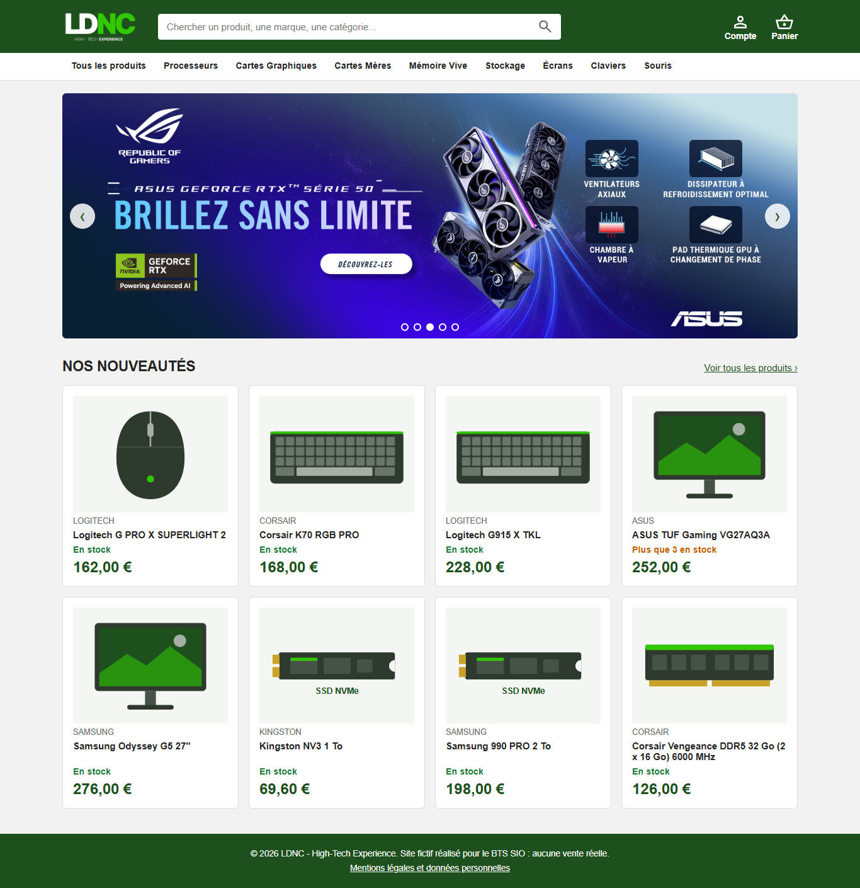

# LDNC - High-Tech Experience

Site e-commerce de matériel informatique, inspiré de LDLC (en vert), réalisé pour le BTS SIO option SLAM.
Le site est fictif : aucune vente réelle, pas de paiement.



## Fonctionnalités

| Pour qui | Ce qu'on peut faire |
|---|---|
| Visiteur | Parcourir le catalogue, rechercher un produit, filtrer (catégorie, marque, prix maximum), trier, voir une fiche produit |
| Client | Créer un compte, se connecter, gérer son panier (ajouter, changer la quantité, retirer, vider), voir le total HT / TVA / TTC |
| Administrateur | Ajouter, modifier et supprimer des produits (prix, TVA, stock, marque, catégorie, image), voir le stock par catégorie |

Le panier est enregistré en base de données : on le retrouve à chaque connexion.

## Technologies

| Partie | Technologie |
|---|---|
| Site (front) | Angular 21, TypeScript, HTML, CSS |
| API (back) | Java 25, Spring Boot 4.1 (Spring MVC, Spring Data JPA / Hibernate, Spring Security, Validation), JWT (jjwt) |
| Base de données | PostgreSQL 18 |
| Tests | JUnit 6, Mockito, MockMvc, base H2 en mémoire (API) ; Vitest (front) |
| Outils | IntelliJ IDEA, Maven (wrapper), npm, Git / GitHub, GitHub Actions |

## Installation et lancement

Prérequis : JDK 25, Node.js 24, PostgreSQL (service démarré).

### 1. Base de données

Créer la base `ldncdb` (une seule fois), puis exécuter les trois scripts **dans l'ordre**.
Dans pgAdmin : clic droit sur `ldncdb` > Query Tool > ouvrir le fichier > Exécuter.
Ou dans un terminal PowerShell, à la racine du projet :

```powershell
& "C:\Program Files\PostgreSQL\18\bin\psql.exe" -U postgres -c "CREATE DATABASE ldncdb"
& "C:\Program Files\PostgreSQL\18\bin\psql.exe" -U postgres -d ldncdb -f database/01_structure.sql
& "C:\Program Files\PostgreSQL\18\bin\psql.exe" -U postgres -d ldncdb -f database/02_sql_avance.sql
& "C:\Program Files\PostgreSQL\18\bin\psql.exe" -U postgres -d ldncdb -f database/03_donnees.sql
```

| Script | Contenu |
|---|---|
| `01_structure.sql` | Les 17 tables et leurs contraintes. Il supprime d'abord les tables : il sert aussi à remettre la base à zéro avant une démonstration |
| `02_sql_avance.sql` | 2 vues, 2 déclencheurs (triggers), 2 procédures stockées |
| `03_donnees.sql` | Comptes de démonstration, catégories, marques, 15 produits |
| `04_requetes_utiles.sql` | Requêtes de consultation à lancer à la main (jointures, regroupements, vues) |

### 2. API Spring Boot (port 8080)

Le mot de passe PostgreSQL se règle dans `backend/src/main/resources/application.properties`
(ou avec la variable d'environnement `DB_PASSWORD`). Puis, dans le dossier `backend` :

```powershell
.\mvnw.cmd spring-boot:run
```

Ou dans IntelliJ : lancer la classe `LdncApplication`. Test rapide : http://localhost:8080/api/produits

### 3. Site Angular (port 4200)

Dans le dossier `webapp` :

```powershell
npm install
npm start
```

Puis ouvrir http://localhost:4200

## Comptes de démonstration

| Rôle | Email | Mot de passe |
|---|---|---|
| Administrateur | admin@ldnc.nc | Admin2026! |
| Client | client@ldnc.nc | Client2026! |

Les mots de passe sont enregistrés en base sous forme d'empreinte BCrypt, jamais en clair.

## Tests

```powershell
cd backend
.\mvnw.cmd test
```

24 tests : calcul du prix TTC, règles du panier, inscription et connexion (tests unitaires avec Mockito),
droits d'accès, validation et parcours complet du panier (tests d'intégration MockMvc sur une base H2).

```powershell
cd webapp
npx ng test --watch=false
```

5 tests : service de connexion et service du panier (Vitest).

À chaque `git push` sur `main` ou `dev`, GitHub Actions relance tous ces tests (fichier `.github/workflows/ci.yml`).

## Organisation du dépôt

```
backend/     API REST Spring Boot
  src/main/java/nc/allan/ldnc/
    controller/   reçoit les requêtes HTTP (une classe par ressource) + gestion des erreurs
    service/      règles métier (connexion, panier, catalogue)
    repository/   accès à la base (Spring Data JPA)
    entity/       classes liées aux tables (JPA)
    dto/          données échangées pour l'inscription et la connexion
    security/     configuration Spring Security, création et lecture des tokens JWT
webapp/      site Angular
  src/app/
    services/     appels à l'API, connexion, panier, intercepteur, guards
    models/       interfaces TypeScript (Produit, Panier, Utilisateur)
    ...           un dossier par page (accueil, produit-list, mon-panier, admin-produits...)
  public/       images (logo, carrousel, illustrations des produits)
database/    scripts SQL (structure, SQL avancé, données de démonstration, requêtes utiles)
docs/        documentation technique, guide utilisateur, cahier de recette, captures d'écran
```

## Documentation

- [Documentation technique](docs/documentation-technique.md) : architecture, modèle de données, API, sécurité, tests
- [Guide utilisateur](docs/guide-utilisateur.md) : utiliser le site (visiteur, client, administrateur)
- [Cahier de recette](docs/cahier-de-recette.md) : scénarios de test et résultats

## Versions

| Version | Date | Contenu |
|---|---|---|
| 0.1 | 06/2026 | Maquette Angular (accueil, connexion, liste des produits), début de l'API |
| 1.0.0 | 11/2026 | Comptes et rôles, recherche et filtres, panier en base, administration des produits, tests, intégration continue |
| 1.1.0 | 11/2026 | SQL avancé : 2 vues, 2 déclencheurs, 2 procédures stockées ; stock par catégorie dans la page Gestion |
