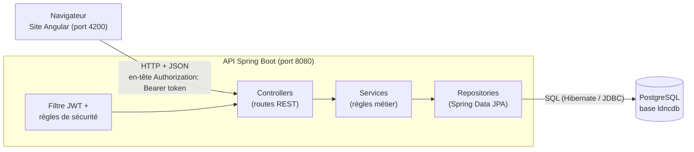
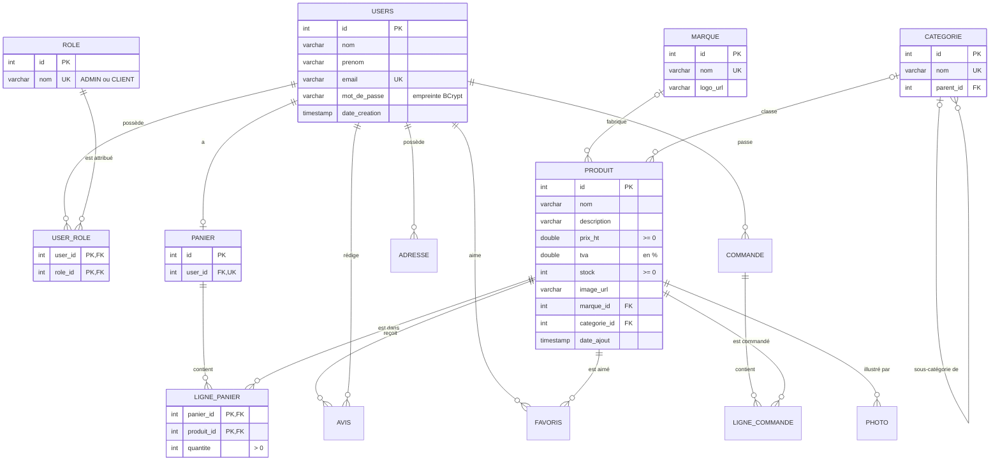
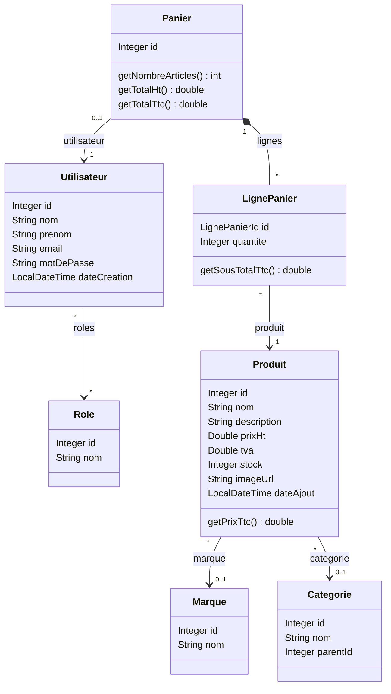
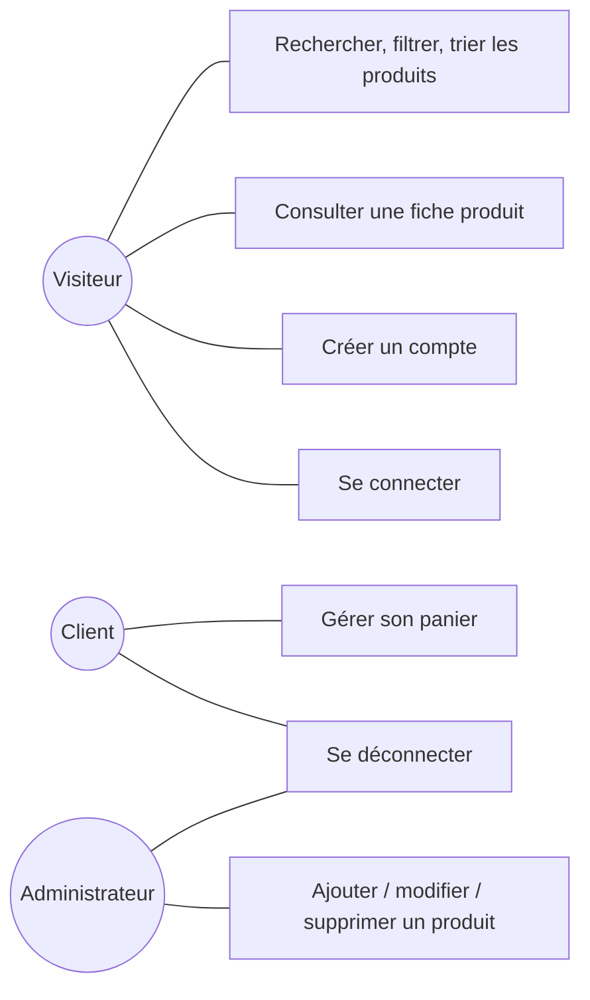
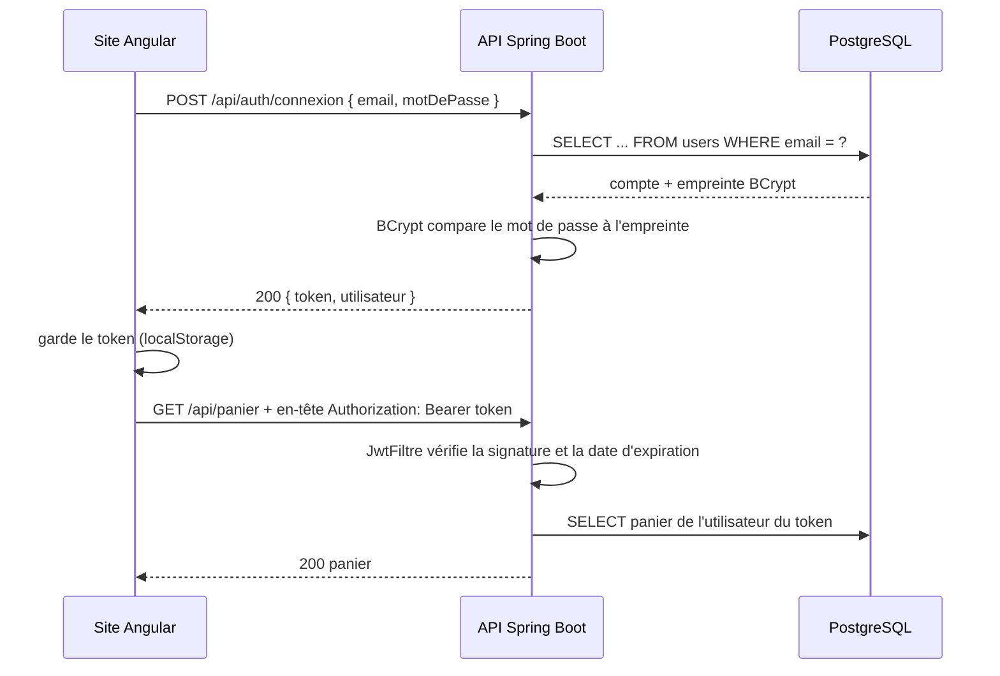

# LDNC - Documentation technique

Version 1.0.0 - novembre 2026

## 1. Contexte et besoin

LDNC est une enseigne fictive de matériel informatique en ligne, sur le modèle de LDLC. Le besoin exprimé :

- présenter un catalogue de produits (composants et périphériques) avec recherche, filtres et tri ;
- permettre aux clients de créer un compte, de se connecter et de constituer un panier enregistré ;
- permettre à un administrateur de gérer le catalogue (ajout, modification, suppression, stock) ;
- **hors périmètre** : le paiement et la commande (le site est un projet de démonstration).

**Contexte juridique (RGPD).** Le site collecte des données personnelles (prénom, nom, email). En conséquence :
seules les données utiles sont demandées (minimisation), l'utilisateur accepte les conditions et la politique de
confidentialité avant de créer son compte, une page « Mentions légales et données personnelles » explique
l'usage des données et les droits, et les mots de passe ne sont jamais stockés en clair (empreinte BCrypt).

## 2. Architecture

Architecture 3 tiers : le site Angular (présentation) appelle une API REST Spring Boot (traitements), qui lit
et écrit dans PostgreSQL (données). Les deux applications échangent du JSON en HTTP.



Dans l'API, chaque couche a un rôle :

| Couche | Rôle | Exemple |
|---|---|---|
| `controller` | Reçoit la requête HTTP, valide les données (`@Valid`), renvoie la réponse | `ProduitController` |
| `service` | Applique les règles métier | `PanierService` : quantité ≤ stock |
| `repository` | Lit et écrit en base, sans écrire de SQL à la main (sauf la recherche en JPQL) | `ProduitRepository` |
| `entity` | Classe Java liée à une table (mapping JPA) | `Produit` ↔ table `produit` |
| `dto` | Données échangées quand l'entité ne doit pas sortir telle quelle | `UtilisateurDto` (sans mot de passe) |
| `security` | Spring Security, création et vérification des tokens JWT | `SecurityConfig`, `JwtFiltre` |

Côté Angular : une page = un composant (dossier `accueil`, `produit-list`, `mon-panier`...), les appels à l'API
sont regroupés dans des services (`services/produit.ts`, `auth.ts`, `panier.ts`), l'état partagé (utilisateur
connecté, nombre d'articles du panier) est gardé dans des **signaux** Angular, ce qui met l'affichage à jour
automatiquement.

## 3. Choix techniques

| Choix | Pourquoi |
|---|---|
| Angular + Spring Boot séparés | Le front et l'API évoluent séparément ; l'API pourrait servir une application mobile |
| PostgreSQL | SGBD relationnel libre, contraintes d'intégrité (clés étrangères, CHECK), déclencheurs |
| Spring Data JPA (Hibernate) | Pas de SQL répétitif : `findById`, `save`, `delete`... ; requêtes paramétrées (pas d'injection SQL) |
| Token JWT | API sans session : chaque requête porte son token signé ; pas de cookie, donc pas de risque CSRF |
| BCrypt | Empreinte lente et salée : deux mots de passe identiques ont des empreintes différentes |
| Panier en base | Le client retrouve son panier sur n'importe quel navigateur |
| Scripts SQL (`ddl-auto=none`) | La structure de la base est maîtrisée et versionnée ; Hibernate ne la modifie jamais |

## 4. Modèle de données

### 4.1 Modèle logique (MLD)

Les tables en gras sont utilisées par la version 1.0. Les autres (photo, avis, favoris, adresse, commande,
ligne_commande, caracteristique, produit_caracteristique, message) sont créées par le script et prévues pour les
évolutions.



Points importants :

- **ligne_panier** a une clé primaire composée `(panier_id, produit_id)` : un produit n'apparaît qu'une fois par
  panier (on augmente sa quantité). En Java, cette clé est la classe `LignePanierId` (`@EmbeddedId` + `@MapsId`).
- **panier.user_id** est `UNIQUE` : un seul panier par compte.
- **user_role** traduit l'association N,N entre utilisateurs et rôles (`@ManyToMany` en Java).
- **categorie.parent_id** référence la même table : « Processeurs » est une sous-catégorie de « Composants ».
- Le **prix TTC n'est pas stocké** : il est calculé à partir de `prix_ht` et `tva`, donc toujours juste.
- Actions sur suppression : supprimer un produit le retire des paniers (`ON DELETE CASCADE`) ; une marque utilisée
  par un produit ne peut pas être supprimée (`ON DELETE RESTRICT`).

### 4.2 Règles dans le SGBD

- Contraintes `CHECK` : prix, TVA et stock positifs, quantité > 0, note d'avis entre 1 et 5.
- Valeurs par défaut : `date_ajout` et `date_creation` = date du jour, `tva` = 20.
- Déclencheur `trg_verifier_stock_panier` : la base refuse une ligne de panier dont la quantité dépasse le stock,
  même si elle est ajoutée sans passer par l'API (deuxième sécurité, l'API fait déjà le contrôle).

### 4.3 Scripts

| Script | Contenu |
|---|---|
| `database/01_structure.sql` | Supprime puis crée les 17 tables, les contraintes et le déclencheur |
| `database/02_donnees.sql` | Rôles, 2 comptes de démonstration, 10 catégories, 8 marques, 15 produits |
| `database/03_requetes_utiles.sql` | Requêtes de consultation : catalogue avec jointures, paniers, totaux (GROUP BY), valeur du stock |

## 5. Diagramme de classes (entités Java)



## 6. Cas d'utilisation



Un client peut aussi faire tout ce que fait un visiteur.

## 7. API REST

Adresse de base : `http://localhost:8080/api`. Les erreurs renvoient `{ "message": "..." }` (classe `GestionErreurs`).

| Méthode | Adresse | Accès | Rôle | Réponses |
|---|---|---|---|---|
| POST | `/auth/inscription` | tous | Créer un compte client (connecte directement) | 201, 400 données invalides, 409 email déjà utilisé |
| POST | `/auth/connexion` | tous | Se connecter, recevoir un token | 200, 401 identifiants incorrects |
| GET | `/produits?recherche=&categorieId=&marqueId=&prixMax=&tri=` | tous | Rechercher (critères facultatifs) | 200 |
| GET | `/produits/{id}` | tous | Détail d'un produit | 200, 404 |
| GET | `/categories` | tous | Liste des catégories | 200 |
| GET | `/marques` | tous | Liste des marques | 200 |
| POST | `/produits` | ADMIN | Ajouter un produit | 201, 400, 401, 403 |
| PUT | `/produits/{id}` | ADMIN | Modifier un produit | 200, 400, 401, 403, 404 |
| DELETE | `/produits/{id}` | ADMIN | Supprimer un produit | 204, 401, 403, 404 |
| GET | `/panier` | connecté | Voir son panier (créé au premier appel) | 200, 401 |
| POST | `/panier/{produitId}?quantite=1` | connecté | Ajouter un produit | 200, 400 stock insuffisant, 404 |
| PUT | `/panier/{produitId}?quantite=2` | connecté | Changer la quantité | 200, 400, 404 |
| DELETE | `/panier/{produitId}` | connecté | Retirer un produit | 200 |
| DELETE | `/panier` | connecté | Vider le panier | 200 |

Valeurs de `tri` : `prix-croissant`, `prix-decroissant`, `nouveautes` (par défaut : par nom).
Une catégorie principale (ex. Composants) renvoie aussi les produits de ses sous-catégories.

Exemple de réponse de `GET /api/panier` :

```json
{
  "id": 1,
  "lignes": [
    { "produit": { "id": 1, "nom": "AMD Ryzen 7 9800X3D", "prixHt": 550.0, "tva": 20.0, "prixTtc": 660.0, "stock": 15, "...": "..." },
      "quantite": 2, "sousTotalTtc": 1320.0 }
  ],
  "nombreArticles": 2,
  "totalHt": 1100.0,
  "totalTtc": 1320.0
}
```

## 8. Sécurité

### 8.1 Connexion avec un token JWT



- Le token contient l'email, les rôles et une date d'expiration (2 h). Il est signé (HMAC-SHA256) avec une clé
  secrète connue de l'API seulement : s'il est modifié, la signature ne correspond plus et il est refusé.
- La clé secrète et le mot de passe de la base viennent de variables d'environnement en production
  (`JWT_SECRET`, `DB_PASSWORD`) ; les valeurs du fichier `application.properties` ne servent qu'au développement.
- L'intercepteur Angular (`auth.interceptor.ts`) ajoute le token à chaque appel. Si l'API répond 401 alors qu'un
  token était envoyé, il a expiré : l'utilisateur est déconnecté et renvoyé vers la page de connexion.

### 8.2 Droits d'accès

Les droits sont vérifiés **par l'API** (`SecurityConfig`) : masquer un bouton dans Angular ne suffit pas, car on peut
appeler l'API directement. Les guards Angular (`guards.ts`) ne servent qu'à rediriger proprement l'utilisateur.

| Qui | Catalogue (GET) | Panier | Ajout / modification / suppression de produits |
|---|---|---|---|
| Visiteur (sans token) | oui | 401 | 401 |
| Client | oui | oui | 403 |
| Administrateur | oui | oui | oui |

### 8.3 Autres protections

| Risque | Protection |
|---|---|
| Vol de mots de passe dans la base | Empreintes BCrypt, jamais de mot de passe en clair ; le DTO `UtilisateurDto` n'expose jamais l'empreinte |
| Deviner quels emails ont un compte | Même message si l'email est inconnu ou si le mot de passe est faux |
| Injection SQL | Requêtes paramétrées (Spring Data, JPQL avec `:parametre`), aucune concaténation de texte dans le SQL |
| XSS | Angular échappe automatiquement les valeurs affichées avec `{{ }}` |
| Données invalides | Validation côté serveur (`@NotBlank`, `@Email`, `@Size`, `@PositiveOrZero`) en plus des contrôles du formulaire |
| Appels depuis un autre site | CORS : seule l'origine du site Angular est autorisée |
| CSRF | Pas de cookie de session : le token est envoyé dans un en-tête, un autre site ne peut pas le joindre |
| Incohérence des données | Contraintes de la base (clés étrangères, CHECK, UNIQUE) et déclencheur sur le stock |

## 9. Tests

| Type | Outil | Fichier | Ce qui est vérifié |
|---|---|---|---|
| Unitaire | JUnit | `ProduitTest` | Calcul et arrondi du prix TTC |
| Unitaire | JUnit + Mockito | `PanierServiceTest` | Ajout, cumul des quantités, stock insuffisant, rupture, retrait |
| Unitaire | JUnit + Mockito | `AuthServiceTest` | Email déjà utilisé, mot de passe haché, mauvais mot de passe |
| Intégration | MockMvc + H2 | `ApiTest` | Droits (401 / 403 / 201), validation, inscription puis connexion, parcours du panier |
| Démarrage | Spring Boot Test | `LdncApplicationTests` | L'application démarre |
| Unitaire front | Vitest | `auth.spec.ts`, `panier.spec.ts` | Connexion, rôle admin, déconnexion, mise à jour du panier |

Les tests de l'API utilisent une base H2 en mémoire (profil `test`) : ils ne touchent pas à PostgreSQL.
Les tests manuels sont décrits dans le [cahier de recette](cahier-de-recette.md).

**Intégration continue** : `.github/workflows/ci.yml` lance les tests de l'API et du site à chaque push sur `main`
ou `dev` et à chaque pull request (onglet Actions du dépôt GitHub).

## 10. Faire évoluer le projet : ajouter un champ à un produit

Exemple : la garantie en années.

1. Base : `ALTER TABLE produit ADD COLUMN garantie INTEGER NOT NULL DEFAULT 2;`
   (et ajouter la colonne dans `01_structure.sql` pour les prochaines installations).
2. API : dans `entity/Produit.java`, ajouter `private Integer garantie;` (Lombok crée le getter et le setter).
   Les contrôleurs et les services n'ont pas besoin d'être modifiés : le champ part et arrive en JSON automatiquement.
3. Site : dans `models/produit.model.ts`, ajouter `garantie: number;` ; dans `admin-produit-form`, ajouter le champ
   au formulaire (et une valeur par défaut dans le nouveau produit) ; l'afficher dans `produit-detail.html`.
4. Relancer l'API, vérifier, puis ajouter un test et mettre à jour cette documentation.

Pour changer la couleur du site : modifier `--vert` au début de `webapp/src/styles.css`.

## 11. Limites connues et évolutions possibles

- Pas de paiement ni de commande (hors périmètre) : les tables `commande` et `ligne_commande` sont prêtes.
- Prix en `double` : en production, `NUMERIC` en base et `BigDecimal` en Java éviteraient tout arrondi.
- Pas de « mot de passe oublié » (il faudrait l'envoi d'emails), pas de pagination du catalogue.
- Évolutions prévues par le modèle de données : avis clients, favoris, galerie de photos, fiche technique, adresses.
- Mise en production : site Angular compilé (`ng build`) servi par un serveur web (Nginx), API lancée en
  `java -jar`, HTTPS, secrets en variables d'environnement, compte PostgreSQL limité à la base `ldncdb`.
