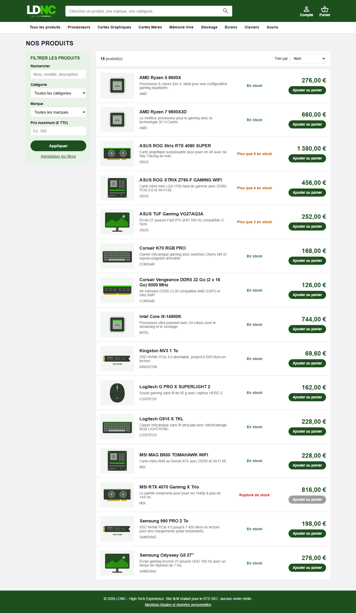
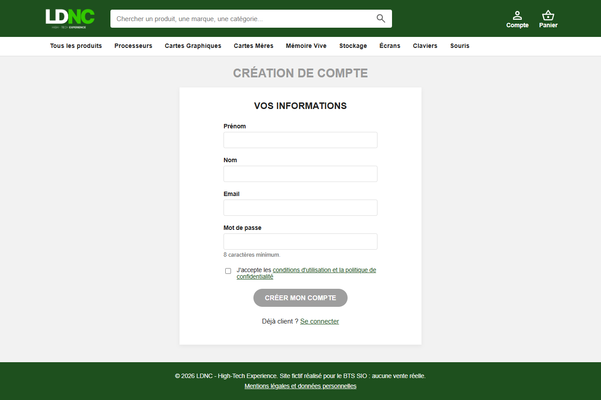
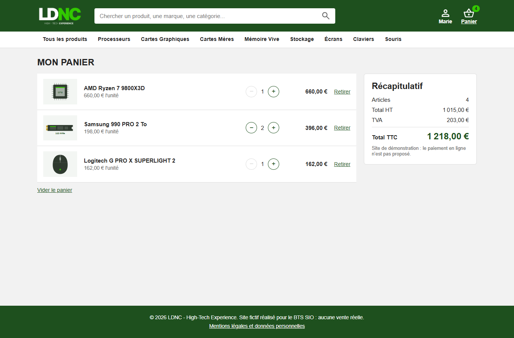
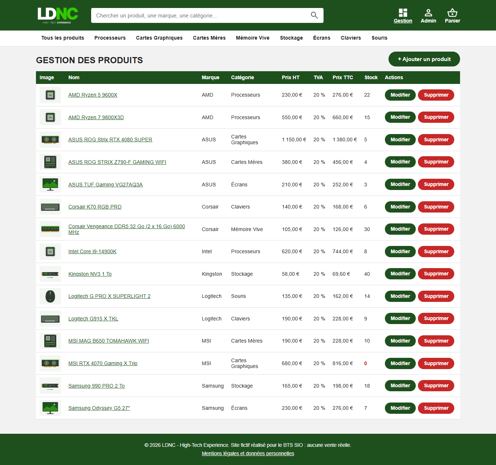
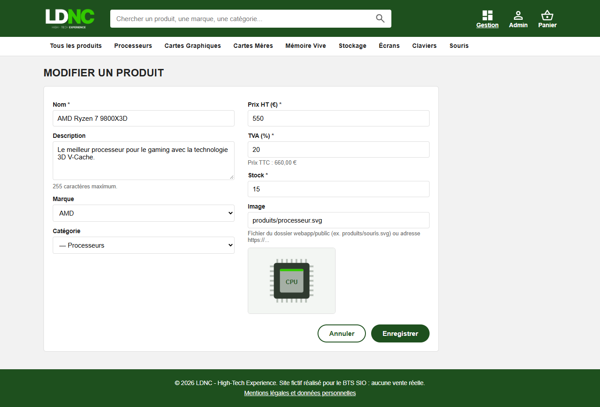

# LDNC - Guide utilisateur

Le site s'ouvre à l'adresse http://localhost:4200 (voir le README pour le lancement).

## 1. Visiteur : trouver un produit

- **Rechercher** : taper un mot dans la barre verte en haut (nom, modèle, mot de la description) puis Entrée
  ou la loupe. Exemple : « ryzen ».
- **Parcourir par catégorie** : cliquer sur une catégorie dans le menu blanc (Processeurs, Écrans...).
- **Filtrer** (colonne de gauche) : catégorie, marque, prix maximum TTC, puis « Appliquer ».
  « Réinitialiser les filtres » affiche de nouveau tout le catalogue.
- **Trier** : liste « Trier par » au-dessus des résultats (nom, prix croissant, prix décroissant, nouveautés).
- **Fiche produit** : cliquer sur le nom ou l'image d'un produit. Elle indique le prix TTC, le prix HT, la TVA
  et la disponibilité :

| Affichage | Signification |
|---|---|
| En stock (vert) | Plus de 5 exemplaires |
| Plus que N en stock (orange) | 5 exemplaires ou moins |
| Rupture de stock (rouge) | Plus aucun exemplaire : le bouton « Ajouter au panier » est grisé |

## 2. Créer un compte et se connecter

1. Cliquer sur **Compte** en haut à droite, puis **Créer un compte**.
2. Remplir prénom, nom, email et mot de passe (8 caractères minimum).
3. Cocher l'acceptation des conditions d'utilisation et de la politique de confidentialité.
4. Cliquer sur **Créer mon compte** : le compte est créé et vous êtes connecté.

Pour se connecter plus tard : **Compte**, saisir l'email et le mot de passe, **Connexion**.
Une fois connecté, votre prénom remplace « Compte » en haut à droite.

La connexion dure 2 heures. Ensuite, le site affiche « Votre session a expiré » : il suffit de se reconnecter.

## 3. Client : gérer son panier

- **Ajouter un produit** : bouton « Ajouter au panier » dans la liste, ou sur la fiche produit après avoir choisi
  la quantité. Si vous n'êtes pas connecté, le site vous demande de vous connecter puis vous ramène sur la page.
- Le nombre d'articles s'affiche sur l'icône **Panier**.
- Dans la page **Panier** : boutons − et + pour changer la quantité, « Retirer » pour enlever un produit,
  « Vider le panier » pour tout enlever (une confirmation est demandée).
- Le récapitulatif affiche le nombre d'articles, le total HT, la TVA et le total TTC.
- On ne peut pas dépasser le stock disponible : le site affiche alors « Stock insuffisant ».
- Le panier est enregistré : vous le retrouvez à la prochaine connexion, même sur un autre ordinateur.

Le paiement n'est pas proposé : LDNC est un site de démonstration.

## 4. Administrateur : gérer les produits

Se connecter avec un compte administrateur : le lien **Gestion** apparaît en haut à droite.

- **Liste** : tous les produits avec leur prix HT, TVA, prix TTC et stock (stock à 0 en rouge).
- **Ajouter** : bouton « + Ajouter un produit », remplir le formulaire, « Enregistrer ».
- **Modifier** : bouton « Modifier » sur la ligne du produit, changer les champs, « Enregistrer ».
  Le prix TTC est recalculé pendant la saisie.
- **Supprimer** : bouton « Supprimer », puis confirmer. La suppression est définitive ; le produit disparaît aussi
  des paniers des clients.

Champs du formulaire :

| Champ | Règle |
|---|---|
| Nom | Obligatoire, 255 caractères maximum |
| Description | Facultative, 255 caractères maximum |
| Marque, catégorie | Choisies dans les listes (ou « Aucune ») |
| Prix HT, TVA, stock | Obligatoires, positifs ou nuls ; TVA en % (20 par défaut) |
| Image | Chemin d'une image du dossier `webapp/public` (ex. `produits/souris.svg`) ou adresse web `https://...` |

Pour ajouter une photo : copier le fichier dans `webapp/public/produits/`, puis saisir `produits/nom-du-fichier.jpg`
dans le champ Image. Un aperçu s'affiche sous le champ.

## 5. Se déconnecter

**Compte** (ou votre prénom) en haut à droite, puis **Se déconnecter**. Le panier n'est plus affiché, mais il reste
enregistré pour votre prochaine connexion.
